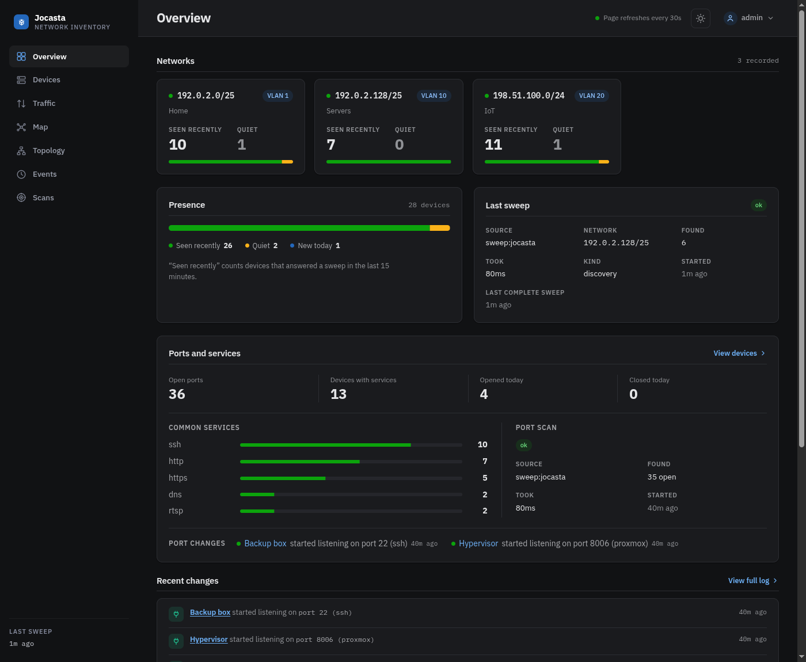

# Jocasta

Jocasta keeps an inventory of the devices on your network and logs every
change. One binary, with a web UI, a JSON API and an MCP server.

!!! warning "Pre-1.0"

    A release can change the config format, the database schema or the API
    with no upgrade path. Pin a version and read the release notes before
    moving on. The version menu at the top picks the docs for your release.

## How it works

1. Sweep the networks you list, every 5 minutes.
2. File each device under its hardware address. Its IP is a lease.
3. Log what changed. Add your router, flow exports and DNS resolver for other
   VLANs, traffic and lookups.

## Start here

-   **[Your first inventory](tutorial.md)**

    Run it, sweep, name a device, get a message when it goes quiet. 10
    minutes.

-   **[How Jocasta works](concepts.md)**

    Devices, scans, sources and presence.

-   **[Plugins](plugins/index.md)**

    Routers, flow exports, DNS resolvers.

-   **[Notifications](notifications/index.md)**

    ntfy, signed webhooks, chat services.

-   **[MCP server](integrations/mcp.md) and [JSON API](integrations/api.md)**

    For agents and scripts.

-   **[Configuration reference](reference/configuration.md)**

    Every setting, its type and default.

## Get help

[GitHub issues](https://github.com/pushkar-anand/jocasta/issues), or
[Fix common problems](operate/troubleshooting.md).

For language models: [`llms.txt`](llms.txt) lists every page as Markdown, and
[`llms-full.txt`](llms-full.txt) holds them all in one file.
