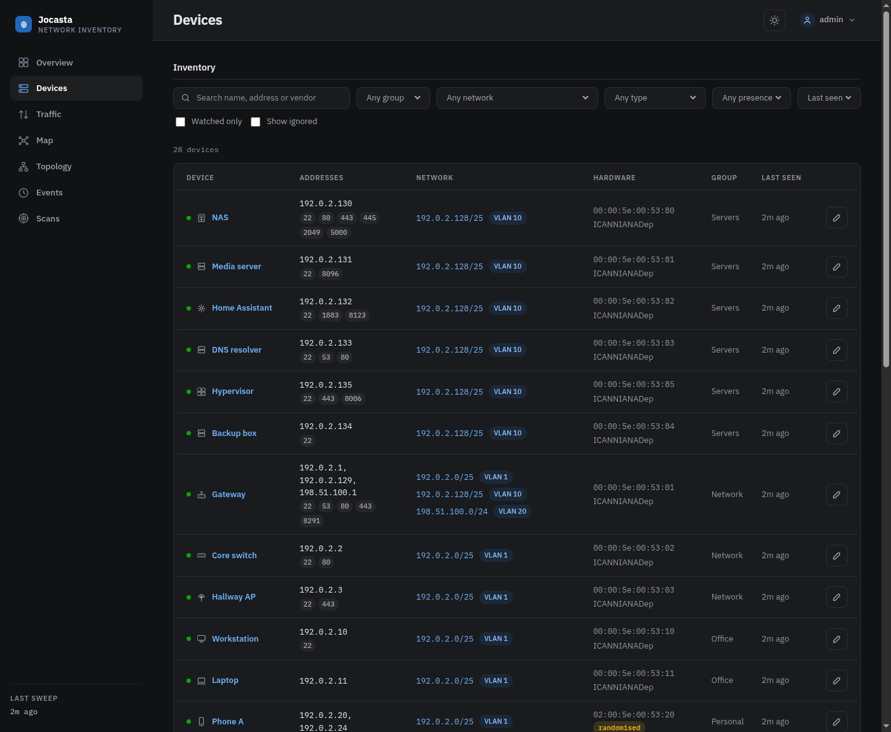
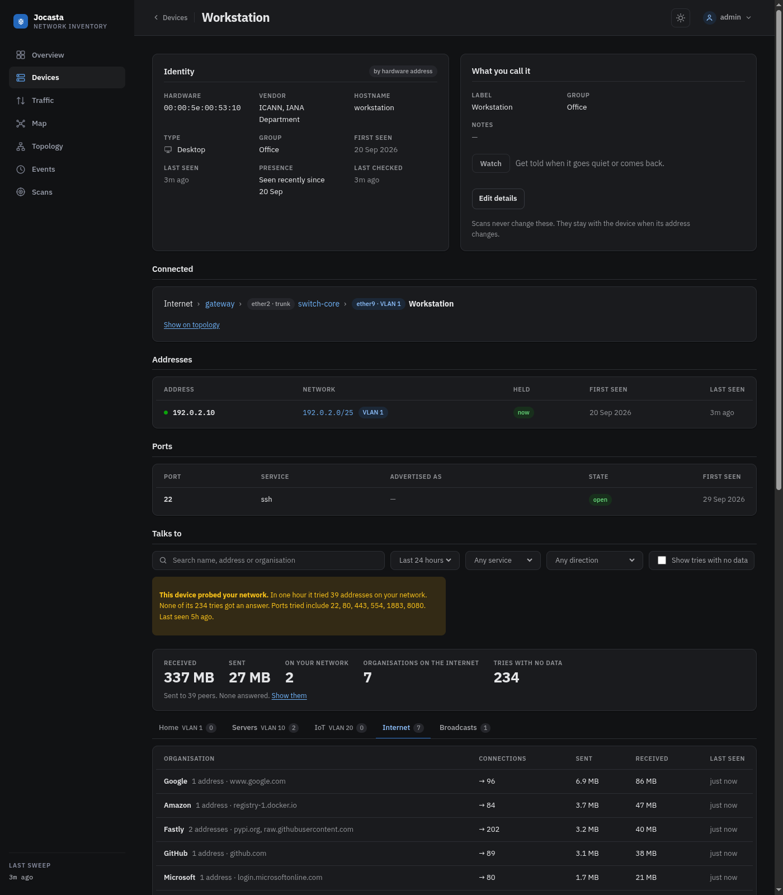
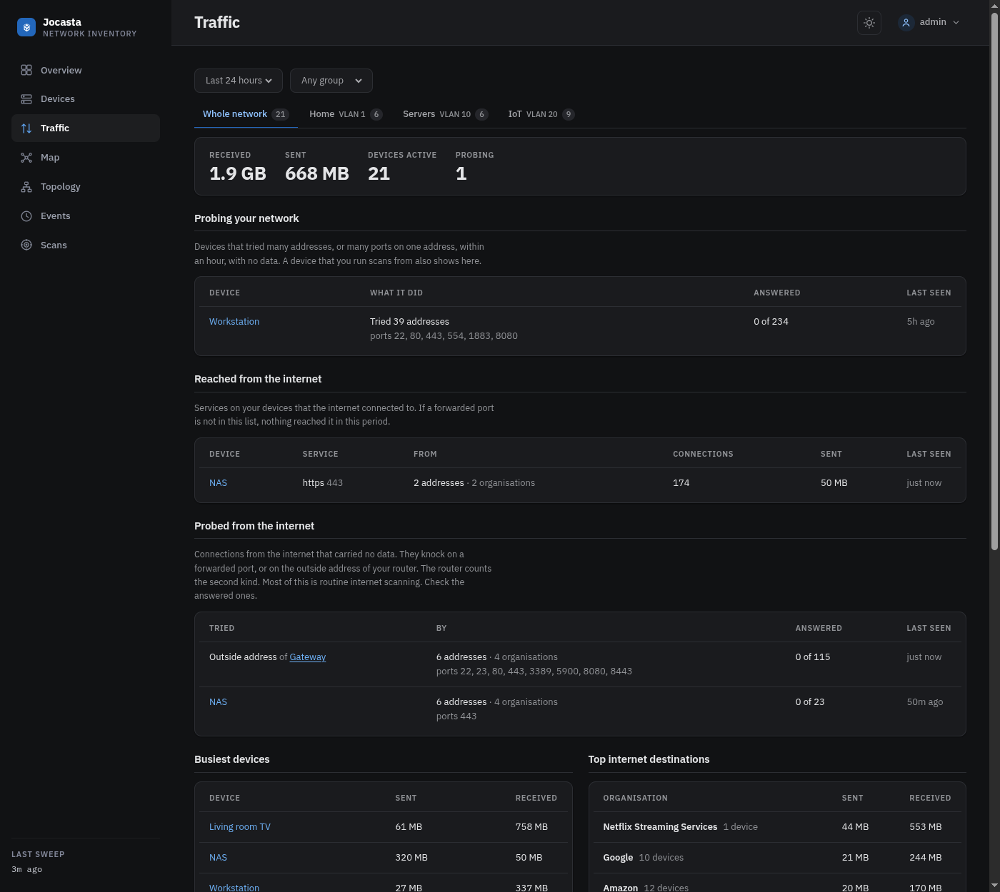
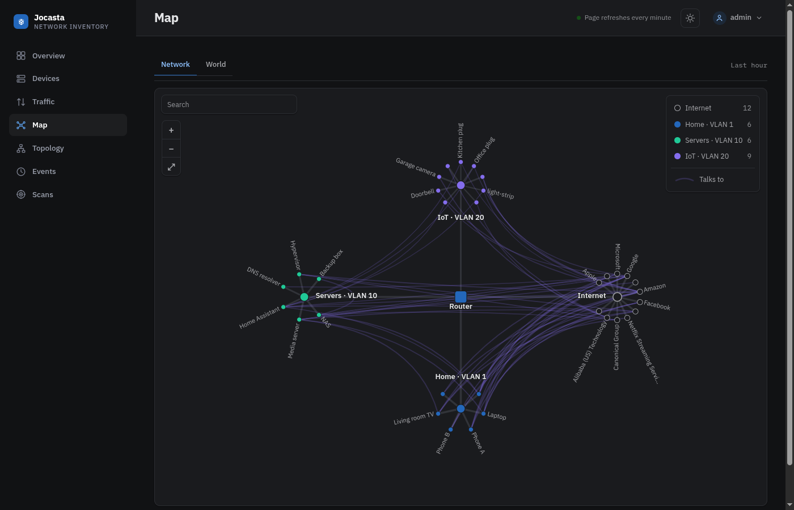
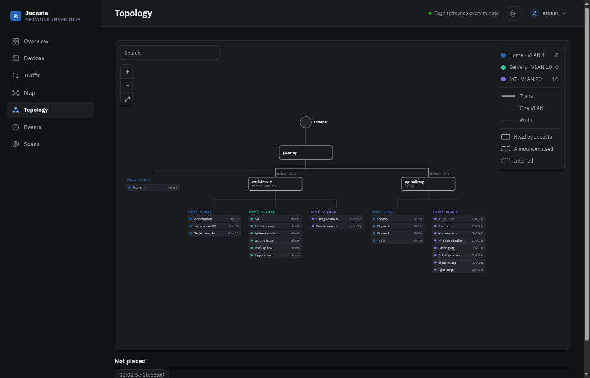
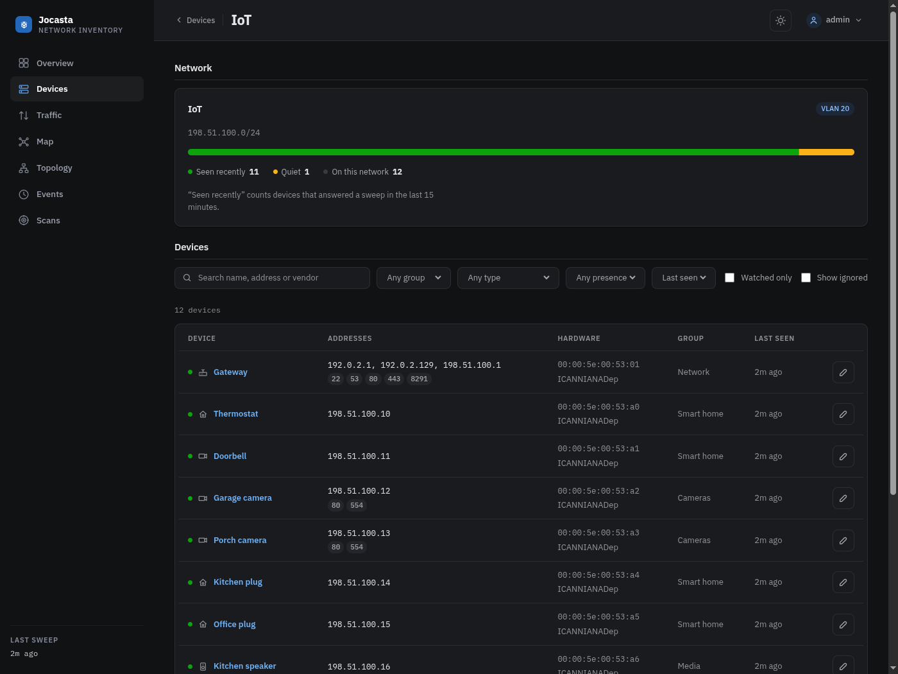
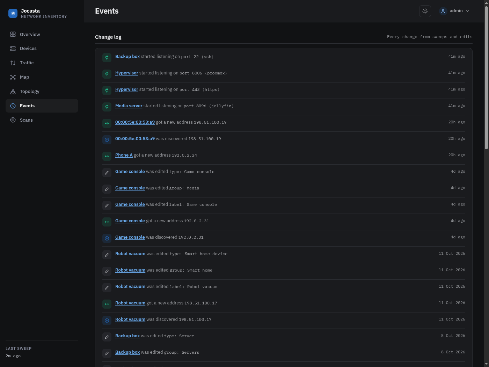
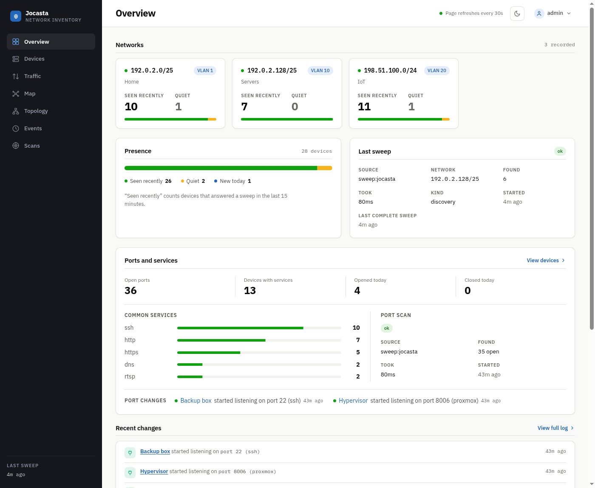

# Tour the web UI

This page shows each page of the web UI. The pages read the same data as the
JSON API. The Overview, Map and Topology pages refresh themselves.

The screenshots below use synthetic data: addresses from RFC 5737, hardware
addresses from RFC 7042, and invented names. The internet peers are
well-known public services, so Jocasta can find their organisations.

## Overview

Counts for each network, a presence summary, the last sweep, and recent
changes.

## Device list

Filter by group, network or presence. Search by name, address or vendor. The
list hides ignored devices, unless you ask for them.

## Device page

Everything that Jocasta knows about one device:

- Identity: what Jocasta found the device to be. It also shows whether
  Jocasta knows the device by its hardware address or only by its IP address.
- What you call it: label, group, type and notes. No scan or plugin changes
  these.
- Connected: the path from the internet to the device, through each router,
  switch and access point. Each step shows the port or Wi-Fi network, the
  band and the VLAN. If the device connects directly to a port that Jocasta
  reads, the page shows the link rate. For a Wi-Fi client, it shows the rate
  in each direction and the signal. If a wired link runs slower than both
  ends can, the page tells you. Show on topology opens the Topology page on
  the device.
- Addresses: every address that the device had, and the network of each
  address.
- Ports: the TCP ports that the device listens on, and the ports that it
  closed since. This section shows only after a port scan reached the device.
  See [CLI](cli.md#ports).
- Sources: the name that each source, such as the sweep or the router, gives
  the device at each address. It also shows when Jocasta last heard from
  each source.
- History: the entries for the device in the change log.

### Talks to

If traffic collection is set up, this section shows who the device exchanged
data with. You can show the last 24 hours, 7 days or 30 days. See
[NetFlow](plugins/netflow.md).

The top of the section shows the data received and sent. It also shows the
number of peers on your network and of organisations on the internet. Below
that, there is one tab for each network segment and one for the internet.
Each tab has a count. The busiest tab opens first.

On the tab of a segment, each peer is one row, for all the services on which
the device reached it. If the peer is a device, the row links to its page.
Addresses that no device has collapse into one row for each subnet. The
Internet tab groups addresses by the organisation that announces them. Use
the search box and the filters to show one service only, or to search by
name, address or organisation.

Each row shows who opened its connections. "→ 12" means that the device
opened 12. "← 3" means that the peer opened 3. A row can show both. The
direction filter shows one side only.

Something on the internet can try to reach the device without exchanging
data, such as a knock on a forwarded port. In that case, a note shows how
many addresses tried, from how many organisations, and on which ports.
Jocasta counts tries on the outside address of the router under the router.
Jocasta learns that address from the flows themselves.

The device can start connections that carry no data, such as a refused port,
a port that nobody answered, or a ping. Jocasta counts these at the top and
does not show them in the tabs. To add them, tick "Show tries with no data".
Each try then goes in the row of its peer, with the number that got an
answer and the ports tried. If the tries add up to probing of the network, a
notice at the top tells you.

The Broadcasts tab lists the packets that the device sent to a whole subnet
or multicast group. Most of these are discovery protocols, such as mDNS,
SSDP, DHCP or a sync tool that looks for its peers. Jocasta guesses the names
from the port and group.

## Traffic page

If traffic collection is set up, this page shows a summary of the whole
network. You can show the last 24 hours, 7 days or 30 days. These are its
cards:

- **Probing your network**: devices that tried 20 or more addresses within
  an hour without exchanging data. Also devices that tried 20 or more ports
  on one address in this way. A device that you run scans from also shows
  here.
- **Reached from the internet**: each device and service that something on
  the internet connected to. This card leaves out a service that uses the
  same port at both ends, such as a VPN server on IKE. Its clients look like
  replies.
- **Probed from the internet**: connections from the internet that carried no
  data, for each device and for the outside address of the router.
- **Busiest devices** and **Top internet destinations**. Each organisation
  opens to show the devices behind it.
- **New this week**: organisations that a device first exchanged data with
  in the last 7 days.

There is a tab for each network segment. A tab shows every card for the
devices of that segment only, with its totals at the top. You can also show
one group only.

The outside address of the router can itself be private. This happens when
the carrier-grade NAT of the ISP, or another router, is in front of it. If
so, the page tells you. Then nothing on the internet can connect in over
IPv4, so the two internet cards stay empty.

## Map

If traffic collection is set up, the Map shows the traffic of the last hour
as a tree. It redraws every minute, because Jocasta records new traffic
every minute.

- The router is in the middle, with a hub for each network and one for the
  internet.
- Devices and organisations spread out around their hub. The Map shows the
  60 busiest devices and the 12 busiest organisations.
- A branch is thicker when more traffic passed along it. It moves if
  something under it was active in the last 15 minutes.
- A faint line joins each device to what it exchanged traffic with: an
  organisation, or a device on another network. Traffic between two devices
  on the same network never passes the router, so the Map does not show it.
- The legend in the top right gives the colour of each network, with its
  device count. Point at a network to show its devices.

Click a device or organisation to highlight its lines. The Map then names
the services on each line ("https", "mqtts", "port 123 UDP") and dims
everything else. Click the device again to open its page. To go back, click
the empty map or press Escape.

To zoom, scroll or pinch. To pan, drag. To zoom in on a spot, double-click
it. The search box dims everything that does not match. Enter zooms to the
first match. The Map keeps the view, the search and the place of each device
when it redraws.

### World

The World tab shows the same internet traffic of the last hour on a map of
the world.

- A country is darker when more traffic went to addresses registered there.
  A marker pulses on the countries that were active in the last 15 minutes.
- A line goes from the country of your network to each of the others. It is
  thicker when it carried more traffic, and it moves while it is active.
- Click a country to see the devices and organisations behind its traffic.
  The search finds countries by name.

The country of your network comes from the outside address of the router. If
that address is private, it comes from `location.country`. See
[NetFlow](plugins/netflow.md).

A country is where an address is registered. For a big provider, this is
often its home country. The server itself can be in a different country.

## Topology

The Topology page shows the network from the internet down. It redraws every
minute. See [Show what is plugged in where](plugins/topology.md).

- The internet is at the top, with the router below it. Each switch and
  access point hangs from the port that it is connected to. A thick line is a
  trunk. A thin line carries one VLAN. A dashed line is Wi-Fi.
- Under each box, the page groups its wired devices by VLAN, with the port of
  each device on the right. It groups its Wi-Fi devices by network, with the
  band of each device.
- A solid box is a device that Jocasta reads. A dashed box is a device that
  only announced itself to a device that Jocasta reads. Jocasta infers a
  dotted box when several devices share one port behind it. If one of these
  devices is a hypervisor, the box is that device. The others are its virtual
  machines. To mark a host that Jocasta did not recognise, set its type to
  Hypervisor on its page. If most devices in a dotted box have the hardware
  address of a virtual machine, the box has the label Hypervisor.
- A quiet device stays where Jocasta last saw it, dimmed. Some devices are
  seen recently, but no router, switch or access point saw them on a port.
  The page lists them under the tree.
- The legend in the top right gives the colour of each VLAN, with its device
  count. Point at a VLAN to show its devices.

Click a device to highlight the path from the internet down to it. Click it
again to open its page. Search, zoom and pan work as on the Map.

## Network page

One segment, its VLAN tag and name, and the devices on it.

## Events

The full change log.

## Light theme

A toggle in the header changes the theme. Each browser keeps its own choice.

